# Biblioteca de anúncios

## Referência 001 — Objeto estranho + regra de decisão

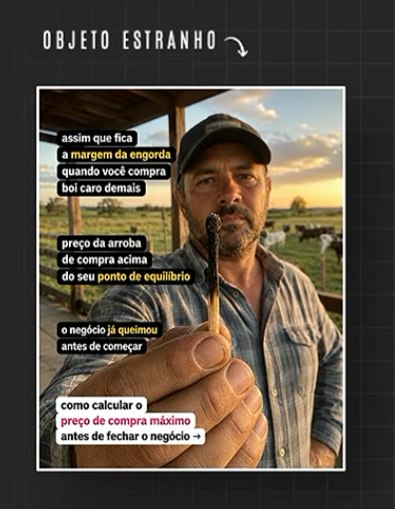

### O que é a ideia

Usar um **objeto incomum e específico como âncora visual**, acompanhado de uma situação real de decisão e de um critério prático que ajuda a evitar um erro caro.

Na peça, o objeto em primeiro plano (uma ferramenta/haste segurada diante da câmera) interrompe a leitura e gera a pergunta “o que é isso?”. O texto conecta essa curiosidade a um problema econômico concreto: comprar por um preço acima do ponto de equilíbrio. A promessa de utilidade aparece como uma regra calculável antes de concluir a transação.

A ideia não depende do objeto literal nem da pecuária. A estrutura transferível é: **objeto visual intrigante → situação de risco ou decisão → custo de agir sem critério → regra ou cálculo que orienta o próximo passo**.

### Como a peça funciona

1. **Interrupção visual:** objeto grande, próximo da lente e parcialmente misterioso; pessoa e ambiente dão contexto.
2. **Curiosidade nomeada:** o título aponta para o “objeto estranho” e conduz o olhar até ele.
3. **Contexto reconhecível:** o texto situa uma decisão comum do público e o erro possível.
4. **Consequência concreta:** apresenta o custo de fechar negócio acima de um limite econômico.
5. **Utilidade acionável:** oferece aprender a calcular um valor-limite antes da decisão.

### Variações do Mecanismo

- **Ferramenta como âncora:** destacar uma ferramenta pouco conhecida e conectá-la à decisão em que ela é útil e ao critério que orienta seu uso.
- **Material ou componente como pista:** aproximar um material, peça ou ingrediente e explicar o que sua condição ou característica indica antes de uma escolha.
- **Documento ou tela como foco:** mostrar um campo, número ou detalhe de um registro que ajude a avaliar uma situação antes de agir.
- **Sinal do ambiente como alerta:** destacar uma característica observável do local ou contexto e relacioná-la a uma decisão que não deve ser tomada às cegas.
- **Comparação visual de opções:** colocar lado a lado duas condições ou itens e explicar qual critério permite escolher entre eles.
- **Consequência concreta em primeiro plano:** usar um objeto ou resultado que represente o custo de uma decisão sem critério e apresentar o parâmetro que poderia ajudar a avaliá-la.

### Adaptação por formato

- **Estático:** objeto dominante no primeiro plano; título curto de curiosidade; texto em blocos de leitura rápida; conclusão em forma de critério ou ação.
- **Vídeo curto:** começar mostrando o objeto sem explicá-lo por completo; revelar a situação em que ele importa; mostrar o risco ou erro; explicar o critério e relacioná-lo ao produto.
- **Carrossel:** capa com objeto e pergunta; sequência com situação, risco, critério e exemplo; última tela com próximo passo coerente.

## Referência 002 — Jogo dos erros / desafio visual

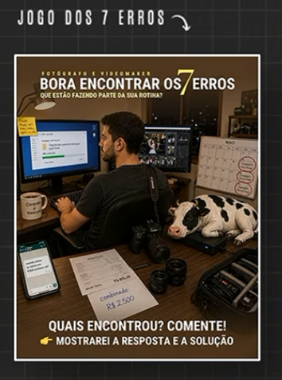

### O que é a ideia

Usar uma **cena visual com vários erros, pistas ou elementos fora do lugar** como desafio para o público identificar. A resposta ou explicação é oferecida como recompensa para quem participar.

Na peça, o cenário representa o ambiente de trabalho do público e reúne objetos e detalhes que sugerem erros. O título define a brincadeira, e a chamada convida a audiência a comentar quantos encontrou, prometendo mostrar a resposta e a solução. A ideia não depende do trabalho de fotografia e vídeo: pode ser adaptada a qualquer contexto em que o público consiga reconhecer problemas visualmente.

### Como a peça funciona

1. **Cena para observar:** apresenta um ambiente ou situação relevante ao público.
2. **Pistas distribuídas:** inclui erros ou inconsistências que podem ser identificados com atenção.
3. **Desafio explícito:** convida a pessoa a contar ou apontar o que encontrou.
4. **Participação simples:** pede uma resposta curta, como comentar a quantidade ou um dos itens.
5. **Recompensa prometida:** oferece revelar a resposta e explicar como corrigir os erros.

### Variações do Mecanismo

- **Encontrar o erro:** apresentar uma cena com um ou mais erros e convidar a audiência a apontá-los antes de revelar a correção.
- **Adivinhar a resposta:** mostrar uma situação ou pergunta com resposta verificável e pedir um palpite antes da explicação.
- **Escolher entre opções:** apresentar alternativas plausíveis e convidar a pessoa a escolher; depois explicar o critério e as consequências.
- **Prever o próximo passo:** interromper um processo antes da decisão ou resultado e perguntar o que aconteceria em seguida.
- **Ordenar etapas:** mostrar ações embaralhadas e pedir que o público indique a sequência correta antes de apresentá-la.
- **Diagnosticar o cenário:** exibir um caso curto com sinais observáveis e perguntar qual problema ou causa merece atenção primeiro.

### Adaptação por formato

- **Estático:** imagem única com erros visíveis, título que apresenta o desafio e chamada para comentar. A resposta pode vir na legenda ou em uma publicação seguinte.
- **Vídeo curto:** mostrar a cena por alguns segundos, convidar a audiência a encontrar os erros e depois revelar cada um com sua explicação.
- **Carrossel:** primeira tela com o desafio; telas seguintes revelam os erros um a um e explicam a correção; última tela resume a solução.

## Referência 003 — Ângulo fofinho / infantilizado

### O que é a ideia

Apresentar o tema ou produto por meio de uma **estética fofa, simpática e infantilizada**, usando formas arredondadas, expressões amigáveis, cores acolhedoras e personagens adoráveis. O ângulo muda a sensação da comunicação: um assunto que poderia parecer técnico, sério ou distante passa a parecer leve, acessível e agradável de explorar.

Na referência, variedades de cogumelo são representadas como pequenos personagens fofos, com rostos expressivos e aparência amigável. A estética infantilizada é o ângulo do criativo; o catálogo de opções é a forma escolhida para aplicá-lo. A ideia pode ser usada em outros nichos sem depender de cogumelos ou de uma lista de variedades.

### Como a peça funciona

1. **Quebra de expectativa visual:** apresenta um tema ou produto com uma aparência mais fofa e lúdica do que o público talvez espere.
2. **Personificação simpática:** dá rosto, expressão e identidade visual ao tema, criando proximidade e facilitando a atenção.
3. **Apresentação leve da informação:** organiza opções e benefícios em blocos simples, mantendo o tom visual acolhedor.
4. **Redução da barreira de entrada:** faz o conteúdo parecer mais amigável e fácil de conhecer, sem depender de uma explicação pesada.
5. **Ação coerente com o tom:** conduz para conhecer, explorar, escolher ou experimentar o produto.

### Variações do Mecanismo

- **Mascotes fofos:** transformar o produto, ferramenta ou tema em personagem com formas arredondadas e expressão amigável.
- **Versão miniatura:** representar itens, ambientes ou processos em escala pequena e adorável, como uma coleção de miniaturas.
- **Ilustração de livro infantil:** usar traços, cenários e cores que lembrem uma história ilustrada para apresentar o tema.
- **Objetos com rosto:** dar expressões simpáticas a ingredientes, componentes, ferramentas ou elementos do produto.
- **Mundo em miniatura:** construir um pequeno universo lúdico ao redor do tema, com personagens e detalhes acolhedores.
- **Transformação fofa do tema:** representar visualmente um assunto normalmente técnico ou intimidador em uma versão mais leve e acessível.

### Adaptação por formato

- **Estático:** ilustrar o tema ou produto com estética fofa e infantilizada; usar formas arredondadas, expressões simpáticas e cores acolhedoras, mantendo texto e chamada legíveis.
- **Vídeo curto:** revelar personagens ou elementos fofos em sequência, combinar movimento leve e expressão visual, e apresentar a informação ou produto sem perder clareza.
- **Carrossel:** usar a mesma linguagem ilustrada em todas as telas para apresentar partes, opções ou etapas do tema como um universo fofo e coerente.
## Referência 004 — Diálogo mental negativo

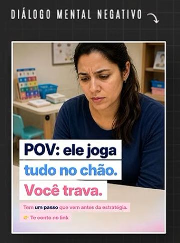

### O que é a ideia

Dar voz a um **pensamento negativo, frustrado ou autocrítico que pode surgir em uma situação cotidiana do público**. A frase funciona como um diálogo interno reconhecível: nomeia o momento difícil de forma direta e aproxima a mensagem da experiência emocional da pessoa.

Na referência, a cena mostra uma mulher preocupada em um ambiente ligado ao cuidado infantil, enquanto o texto apresenta uma situação frustrante relacionada a uma criança e conclui com “Você trava”. A chamada direciona para uma estratégia oferecida por meio do link. A estrutura pode ser adaptada a outros contextos, substituindo a situação e o pensamento por algo que faça sentido para aquele público.

### Como a peça funciona

1. **Situação cotidiana:** mostra uma cena que ajuda a pessoa a reconhecer o contexto.
2. **Pensamento em primeira pessoa:** expressa uma reação interna curta e emocional, como alguém poderia formulá-la para si.
3. **Reconhecimento da dificuldade:** conecta o pensamento a uma sensação ou impasse, sem exigir explicação longa.
4. **Ponte para uma possibilidade:** apresenta uma estratégia, orientação ou próximo passo relacionado à situação.
5. **Chamada para ação:** indica onde encontrar a ajuda ou o conteúdo oferecido.

### Variações do Mecanismo

- **Frustração imediata:** verbalizar o pensamento que surge logo após uma situação não sair como esperado.
- **Autocrítica:** expressar a cobrança que a pessoa faz a si mesma diante de uma dificuldade recorrente.
- **Medo de piorar:** trazer o receio interno de que uma ação ou decisão leve a uma consequência indesejada.
- **Sensação de impotência:** representar o pensamento de não saber o que fazer em um momento específico.
- **Conflito interno:** colocar em palavras duas vontades ou receios que disputam a decisão da pessoa.
- **Pensamento antes de agir:** mostrar a dúvida ou hesitação que aparece imediatamente antes de uma ação importante.

### Adaptação por formato

- **Estático:** usar uma imagem contextual e destacar o pensamento em poucas linhas; conectar a frase a uma orientação ou próximo passo relevante.
- **Vídeo curto:** encenar a situação, inserir o diálogo interno como texto ou narração e concluir com uma possibilidade de ação relacionada ao produto.
- **Carrossel:** apresentar a situação e o pensamento inicial; desenvolver a dificuldade ou conflito nas telas seguintes; fechar com uma estratégia ou próximo passo.

## Referência 005 — Surrealismo / cena impossível

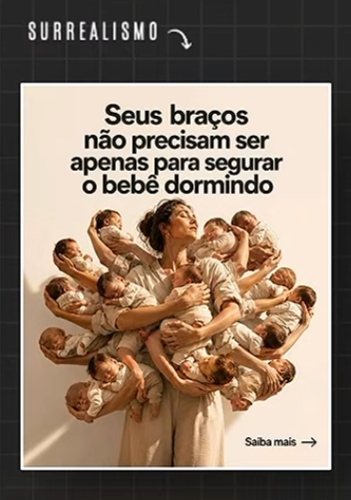

### O que é a ideia

Usar uma **imagem surreal ou impossível de acontecer literalmente** para representar visualmente uma ideia, uma sensação ou uma afirmação sobre o produto. A cena inesperada interrompe a leitura e transforma uma mensagem abstrata em uma imagem marcante.

Na referência, muitos bebês aparecem agrupados nos braços de uma única mulher, numa representação impossível que ilustra a frase sobre os braços de uma mãe servirem para mais do que segurar o bebê enquanto ele dorme. O absurdo visual dá forma à sobrecarga e ao cuidado constante, sem precisar mostrar uma cena cotidiana literal. O surrealismo é o ângulo; a quantidade impossível de bebês é a execução usada para expressá-lo. Em outra execução, um moletom sem corpo representa simbolicamente a sensação de ser invisível nas redes sociais. Assim, o surreal pode aparecer como exagero impossível ou como símbolo visual irreal que dá forma a uma ideia abstrata.

### Como a peça funciona

1. **Imagem inesperada:** apresenta uma cena impossível, exagerada ou deslocada do cotidiano.
2. **Mensagem que dá sentido:** o texto direciona a interpretação da imagem para uma ideia específica.
3. **Metáfora visual:** o surrealismo representa uma sensação, dificuldade, desejo ou benefício de forma concreta.
4. **Contraste memorável:** a diferença entre a cena extraordinária e uma situação reconhecível aumenta o impacto da mensagem.
5. **Próximo passo:** a chamada conduz a pessoa a conhecer mais sobre a solução ou produto relacionado.

### Variações do Mecanismo

- **Exagero de quantidade:** multiplicar pessoas, objetos ou elementos para representar intensidade, volume ou sobrecarga.
- **Escala impossível:** tornar algo minúsculo ou gigante para expressar sua importância, dificuldade ou impacto percebido.
- **Combinação improvável:** misturar elementos que normalmente não apareceriam juntos para tornar uma ideia visível.
- **Metáfora literalizada:** transformar uma expressão ou sensação em uma cena visual concreta, mesmo que impossível.
- **Símbolo surreal:** usar uma figura ou objeto irreal para representar um estado abstrato, como invisibilidade, ausência ou anonimato.
- **Gravidade ou física alterada:** fazer objetos flutuarem, se curvarem ou se moverem de modo impossível para representar um estado ou transformação.
- **Cenário cotidiano deslocado:** inserir uma situação absurda em um ambiente familiar para criar contraste e comunicar uma mensagem.

### Adaptação por formato

- **Estático:** construir uma única cena surreal, legível à primeira vista, e associá-la a uma frase que deixe clara a metáfora ou ideia representada.
- **Vídeo curto:** revelar a cena impossível, mostrar como ela se conecta à situação do público e concluir com a mensagem ou solução.
- **Carrossel:** apresentar primeiro a imagem ou situação surreal; nas telas seguintes, explicar seus elementos e conectá-los à ideia, benefício ou oferta.

## Referência 006 — UGC-style / relato em primeira pessoa

### O que é a ideia

Usar uma execução em estilo **conteúdo gerado por usuário (UGC-style)**, com uma pessoa em um ambiente cotidiano relatando uma experiência ou resultado em primeira pessoa. O relato cria uma sensação de proximidade e conversa; a ideia central da mensagem continua sendo específica ao benefício ou resultado apresentado.

Na referência, uma mulher aparece em um ambiente doméstico, à noite, com um bebê no colo e olhando para o celular. O texto diz que ela acordou de madrugada e encontrou uma venda feita enquanto dormia, atribuindo isso ao uso de agentes de IA. O estilo é informal e pessoal; o ângulo da mensagem é obter uma venda enquanto dorme por meio de automação. A imagem não confirma se a pessoa é cliente, criadora contratada ou atriz, então a autenticidade do relato não pode ser verificada apenas pelo print.

### Como a peça funciona

1. **Cena cotidiana:** mostra uma pessoa em um ambiente familiar e reconhecível, em vez de uma produção publicitária ostensiva.
2. **Relato em primeira pessoa:** apresenta o acontecimento como experiência pessoal, com linguagem direta.
3. **Resultado específico:** destaca uma consequência desejável que chama atenção e desperta curiosidade.
4. **Mecanismo atribuído:** relaciona o resultado ao produto ou processo mencionado, neste caso agentes de IA trabalhando durante a noite.
5. **Chamada para saber mais:** direciona para um link onde a pessoa pode conhecer a explicação ou a oferta.

### Variações do Mecanismo

- **Descoberta inesperada:** relatar algo que a pessoa encontrou ou percebeu ao usar o produto em uma situação comum.
- **Relato de rotina:** mostrar como o produto se encaixa em um momento cotidiano e o que mudou naquela rotina.
- **Pequena vitória:** destacar um avanço específico, mantendo o relato proporcional e fiel à experiência real.
- **Resultado durante uma ausência:** mostrar um processo ou recurso funcionando enquanto a pessoa dorme, trabalha ou está ocupada, desde que isso seja verdadeiro e demonstrável.
- **Reação em primeira pessoa:** registrar surpresa, alívio ou satisfação diante de uma experiência real com o produto.
- **Relato com demonstração:** combinar fala pessoal com imagens que mostrem o uso do produto ou evidência verificável do que está sendo contado.

### Adaptação por formato

- **Estático:** usar uma cena cotidiana com a pessoa e destacar o relato em primeira pessoa como texto principal; manter o resultado específico e a chamada legíveis.
- **Vídeo curto:** apresentar a pessoa em contexto natural, abrir com o acontecimento ou descoberta, explicar brevemente o papel do produto e concluir com uma chamada para saber mais.
- **Carrossel:** contar o relato em etapas — situação, descoberta, papel do produto e próximo passo — usando imagens ou registros compatíveis com a experiência apresentada.

## Referência 007 — Jeito certo x errado

### O que é a ideia

Comparar visualmente **uma forma inadequada e uma forma recomendada de realizar uma tarefa**, para mostrar um erro que pode passar despercebido e apresentar um critério mais apropriado. A oposição “errado x certo” torna o aprendizado rápido de entender e fácil de lembrar.

Na referência, a mesma pessoa aparece em dois momentos usando produtos de skincare. Cada lado recebe um rótulo e uma instrução contrastante sobre quando aplicar os ativos. A comparação aponta uma combinação inadequada e destaca a sequência indicada pela peça. A estrutura pode ser aplicada a outras tarefas, desde que a diferença e suas consequências sejam corretas para aquele contexto.

### Como a peça funciona

1. **Situação familiar:** mostra uma tarefa que o público realiza ou pode precisar realizar.
2. **Contraste direto:** coloca lado a lado duas formas de agir, identificadas como inadequada e recomendada.
3. **Critério observável:** explica qual regra, ordem ou escolha diferencia as duas abordagens.
4. **Consequência ou benefício:** indica o que pode acontecer quando o critério é ignorado ou seguido.
5. **Próximo passo:** conecta a explicação a uma orientação, solução ou produto relacionado.

### Variações do Mecanismo

- **Sequência certa x errada:** comparar a ordem inadequada e a recomendada para executar etapas.
- **Escolha certa x errada:** contrastar duas opções e explicar qual critério deve orientar a escolha.
- **Hábito certo x errado:** mostrar um comportamento comum que atrapalha e uma alternativa mais adequada.
- **Exemplo certo x errado:** comparar duas aplicações, respostas, configurações ou resultados observáveis.
- **Mito x correção:** apresentar uma crença frequente como ponto de partida e explicar a informação que a corrige.
- **Antes da correção x depois da correção:** mostrar uma tarefa ou processo antes e depois de aplicar a conduta recomendada, sem sugerir resultados além do que a evidência sustenta.

### Adaptação por formato

- **Estático:** dividir a imagem em dois lados bem identificados, com uma instrução breve e o critério que explica a diferença.
- **Vídeo curto:** encenar primeiro o erro, apontar por que ocorre e demonstrar a forma recomendada.
- **Carrossel:** apresentar o erro ou a dúvida inicial; dedicar telas à comparação e à explicação; finalizar com o critério ou próximo passo.

## Referência 008 — Notícia / afirmação atribuída a estudo

### O que é a ideia

Apresentar uma mensagem promocional com **linguagem e aparência de notícia ou conteúdo editorial**, usando uma afirmação atribuída a um estudo, descoberta ou fonte especializada como gancho para introduzir uma explicação e uma oferta.

Na referência, o criativo usa uma pessoa em destaque, elementos gráficos de uma publicação editorial e a chamada de que um estudo aponta uma relação entre a ordem de uso de produtos e o envelhecimento da pele. Em seguida, apresenta uma sequência de skincare e convida a continuar lendo. A aparência de notícia é o enquadramento; a alegação e a fonte precisam ser verificadas antes de qualquer adaptação.

### Como a peça funciona

1. **Enquadramento editorial:** usa elementos visuais associados a notícia, estudo ou informação especializada.
2. **Afirmação de impacto:** apresenta uma descoberta ou relação como motivo para prestar atenção.
3. **Contexto visual:** inclui pessoa, produto ou diagrama que ajuda a entender o tema rapidamente.
4. **Explicação introdutória:** oferece um resumo ou sequência que amplia a afirmação.
5. **Continuação da leitura:** usa uma chamada para levar a pessoa a uma matéria, página ou conteúdo mais completo.

### Variações do Mecanismo

- **Estudo como gancho:** introduzir um dado ou conclusão de pesquisa real, identificando a fonte e o contexto.
- **Nova descoberta:** apresentar uma informação recente e relevante, com data e atribuição verificáveis.
- **Explicação de especialista:** usar a fala ou análise de uma pessoa qualificada para contextualizar um tema, com identificação correta.
- **Fato pouco conhecido:** destacar uma informação verificável que altere a forma como o público entende uma situação.
- **Mudança de orientação:** explicar como uma recomendação evoluiu à luz de evidências ou diretrizes atualizadas, deixando claro o escopo.
- **Notícia comentada:** apresentar uma manchete ou fato e acrescentar contexto útil, distinguindo a informação original da interpretação.

### Adaptação por formato

- **Estático:** usar hierarquia visual editorial, manchete informativa, fonte identificável e resumo curto; direcionar para o conteúdo completo.
- **Vídeo curto:** abrir com a informação ou manchete, identificar a fonte, explicar o contexto e concluir com a recomendação ou chamada pertinente.
- **Carrossel:** apresentar a afirmação e sua fonte; explicar contexto, evidências e implicações em telas seguintes; fechar com resumo e próximo passo.

## Referência 009 — Checklist de comparação

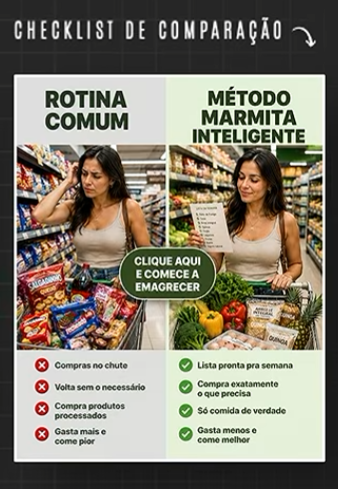

### O que é a ideia

Colocar lado a lado **uma rotina ou abordagem comum e uma alternativa organizada por método**, comparando-as por meio de itens curtos de checklist. A composição ajuda o público a reconhecer hábitos, enxergar diferenças e entender a proposta de uma nova forma de agir.

Na referência, duas versões de uma ida ao mercado são comparadas: compras impulsivas e pouco planejadas de um lado, compras organizadas por uma lista do outro. Cada lado tem uma imagem correspondente e itens marcados com símbolos de erro ou confirmação. O exemplo associa o método de compras a emagrecimento; a estrutura pode ser transferida para outras rotinas ou processos.

### Como a peça funciona

1. **Dois caminhos reconhecíveis:** nomeia uma rotina habitual e uma alternativa organizada.
2. **Correspondência visual:** cada lado mostra uma cena que representa o caminho descrito.
3. **Checklist objetivo:** resume diferenças em itens curtos e fáceis de comparar.
4. **Sinalização rápida:** usa ícones, cores ou marcações para distinguir dificuldades de práticas recomendadas.
5. **Ponte para a solução:** destaca o método ou produto associado à alternativa e convida a conhecê-lo.

### Variações do Mecanismo

- **Improviso x planejamento:** comparar decisões tomadas na hora com uma rotina preparada de antemão.
- **Forma comum x método organizado:** contrastar uma prática recorrente com um processo estruturado em etapas.
- **Com ferramenta x sem ferramenta:** mostrar como um recurso específico altera a organização ou execução da tarefa.
- **Checklist incompleto x completo:** destacar itens que costumam ser esquecidos e uma lista que ajuda a cobri-los.
- **Muito esforço x esforço direcionado:** comparar atividades dispersas com ações priorizadas por um critério claro.
- **Rotina anterior x rotina ajustada:** mostrar diferenças concretas após uma mudança de processo, sem sugerir resultados não demonstrados.

### Adaptação por formato

- **Estático:** dividir o layout em duas colunas, com título claro para cada caminho, imagem correspondente e poucos itens de checklist.
- **Vídeo curto:** alternar cenas dos dois modos de agir e apresentar as diferenças como uma lista visual ou narrada.
- **Carrossel:** introduzir os dois caminhos, detalhar um ou mais itens por tela e concluir com o método, ferramenta ou próximo passo.

## Referência 010 — Meme

### O que é a ideia

Usar **humor, identificação ou referência cultural em formato de meme** para apresentar uma situação reconhecível pelo público e relacioná-la ao produto ou à ação desejada. O meme é o tipo geral de criativo; a cena específica é apenas uma das muitas formas de executá-lo.

Na referência, uma corredora que acaba de cruzar a linha de chegada aponta para a câmera com expressão de alegria e provocação. O texto transforma a cena em uma brincadeira sobre chegar antes do amigo, e a chamada conecta o humor a um treino de corrida. A estrutura pode ser adaptada a outros produtos e situações, escolhendo uma referência ou contraste que o público compreenda.

### Como a peça funciona

1. **Formato reconhecível:** usa uma imagem, expressão, situação ou construção que remete a meme.
2. **Situação identificável:** o texto associa a imagem a uma experiência cotidiana ou compartilhada pelo público.
3. **Quebra humorística:** exagero, contraste, ironia ou surpresa transforma a situação em piada.
4. **Conexão com a oferta:** relaciona a brincadeira ao produto, serviço ou atividade anunciada.
5. **Chamada integrada:** convida a agir mantendo o tom leve do meme.

### Variações do Mecanismo

- **Situação de identificação:** retratar um hábito, dificuldade ou momento que o público reconhece imediatamente.
- **Expectativa x realidade:** contrastar o que a pessoa imagina que vai acontecer com o que costuma acontecer.
- **Reação exagerada:** usar uma expressão ou resposta desproporcional para brincar com uma situação comum.
- **Personagem ou arquétipo:** representar tipos de comportamento conhecidos, com humor ligado à experiência do público.
- **Referência cultural:** adaptar um formato, bordão ou imagem reconhecível, respeitando contexto e direitos de uso.
- **Autodepreciação leve:** brincar com um erro ou dificuldade compartilhada sem humilhar o público.
- **Meme de nicho:** usar uma piada interna ou referência específica que faça sentido para a comunidade escolhida.

### Adaptação por formato

- **Estático:** combinar uma imagem de reação ou situação com texto curto que complete a piada e conecte ao tema da oferta.
- **Vídeo curto:** encenar a situação, construir a expectativa e entregar a quebra humorística antes de apresentar a conexão com o produto.
- **Carrossel:** desenvolver a piada em etapas, usando cada tela para preparar a virada ou mostrar variações da situação.

## Referência 011 — Exagero visual

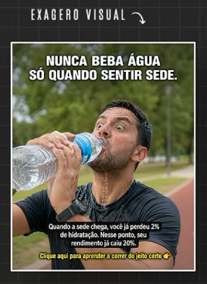

### O que é a ideia

Usar **hipérbole visual** para representar uma situação, recomendação ou consequência de forma muito maior, intensa ou dramática do que aconteceria literalmente. O exagero chama a atenção e dá forma imediata à mensagem, enquanto o texto explica a interpretação pretendida.

Na referência, um homem bebe de uma garrafa enorme e reage de maneira exagerada. A imagem dramatiza a mensagem sobre não esperar sentir sede para beber água; o texto acrescenta uma explicação sobre hidratação e desempenho na corrida. O exagero é o ângulo visual. A afirmação quantitativa sobre hidratação é uma alegação separada e não pode ser validada apenas pelo criativo.

### Como a peça funciona

1. **Elemento exagerado:** aumenta o tamanho, a quantidade ou a intensidade de algo familiar.
2. **Reação marcante:** usa gesto, expressão ou situação que evidencia o exagero.
3. **Mensagem de ancoragem:** texto ou contexto deixa claro o que a imagem representa.
4. **Explicação:** conecta o exagero a uma recomendação, problema ou consequência pertinente.
5. **Chamada para ação:** direciona para aprender, conhecer ou aplicar a solução apresentada.

### Variações do Mecanismo

- **Escala exagerada:** tornar um objeto, obstáculo ou resultado desproporcionalmente grande ou pequeno.
- **Quantidade exagerada:** multiplicar itens, tarefas ou efeitos para representar volume ou intensidade.
- **Reação exagerada:** dramatizar uma resposta emocional ou física a uma situação reconhecível.
- **Acúmulo visual:** empilhar ou reunir elementos para mostrar excesso, desorganização ou sobrecarga.
- **Comparação de intensidade:** representar visualmente uma diferença extrema entre duas condições ou resultados.
- **Literalização de expressão:** transformar uma frase figurada ou sensação em uma cena exagerada e concreta.

### Adaptação por formato

- **Estático:** concentrar o exagero em um elemento visual dominante e adicionar texto curto que esclareça a mensagem.
- **Vídeo curto:** revelar ou construir o exagero em etapas, usando reação, escala ou acúmulo para preparar a explicação.
- **Carrossel:** mostrar o exagero primeiro e usar as telas seguintes para explicar o que ele representa e conectar a ideia à solução.

## Referência 012 — Quadrinhos

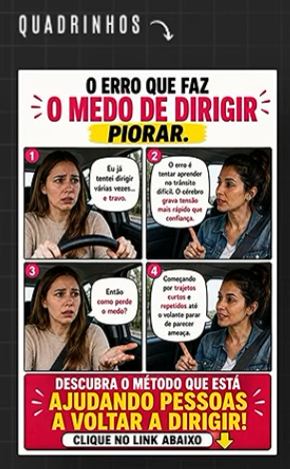

### O que é a ideia

Usar **quadros sequenciais, personagens e diálogos** para transformar uma situação em uma narrativa curta. O formato permite mostrar uma dificuldade, desenvolver uma conversa ou explicação e apresentar um caminho possível de forma visual e fácil de acompanhar.

Na referência, quatro quadros mostram uma pessoa com medo de dirigir, conversando com alguém que explica possíveis causas e um método para voltar a dirigir. Balões de fala conduzem a história, e o quadro final apresenta a oferta e a chamada. O tema específico pode mudar; a estrutura narrativa em quadrinhos permanece.

### Como a peça funciona

1. **Personagem e situação:** apresenta alguém em um contexto reconhecível para o público.
2. **Problema ou tensão:** mostra uma dificuldade, dúvida ou objetivo que move a história.
3. **Diálogo ou desenvolvimento:** usa falas e reações para explorar a situação ou introduzir uma explicação.
4. **Caminho possível:** apresenta uma ideia, método ou solução relacionada ao problema.
5. **Fechamento e chamada:** conclui a narrativa e indica o próximo passo.

### Variações do Mecanismo

- **Problema e orientação:** personagem apresenta uma dificuldade e outra pessoa oferece uma explicação ou caminho.
- **Diálogo interno:** mostrar, em quadros, o conflito entre pensamentos, receios ou vontades de um personagem.
- **Tentativa e aprendizado:** acompanhar uma tentativa, um erro e o que o personagem aprende com ele.
- **Mito e esclarecimento:** um personagem expressa uma crença comum; a sequência apresenta contexto ou correção.
- **Duas perspectivas:** representar o mesmo acontecimento pela visão de personagens diferentes.
- **Passo a passo narrativo:** usar cenas em quadrinhos para explicar etapas de uma tarefa ou processo.
- **Humor de situação:** construir uma pequena piada visual em sequência e conectá-la ao tema da oferta.

### Adaptação por formato

- **Estático:** organizar vários quadros em uma única peça, com leitura clara, falas curtas e ordem visual evidente.
- **Vídeo curto:** animar ou encenar os quadros, usando narração, balões ou legendas para acompanhar a progressão da história.
- **Carrossel:** distribuir os quadros ao longo das telas, mantendo uma cena ou momento narrativo por tela e fechando com a conclusão ou chamada.

## Referência 013 — Autoridade / sinais de reconhecimento

### O que é a ideia

Usar **sinais de reconhecimento, experiência ou validação** para posicionar uma pessoa, produto ou método como autoridade em determinado assunto. A imagem e a mensagem apresentam indicadores de destaque como suporte para uma afirmação de credibilidade.

Na referência, um homem aparece diante de prêmios e certificados, segurando um grande selo de “número 1 / curso mais vendido”. O texto afirma que o curso de marketing digital é o que mais vende todos os anos e convida a conhecer por que domina o mercado. A estrutura pode ser adaptada a diferentes áreas com evidências próprias; os símbolos de autoridade precisam corresponder a fatos verificáveis.

### Como a peça funciona

1. **Figura de autoridade:** apresenta uma pessoa associada à experiência, criação ou liderança do produto.
2. **Sinais visuais de reconhecimento:** exibe prêmios, certificados, rankings, resultados ou outros indicadores relevantes.
3. **Afirmação de destaque:** conecta esses sinais a uma alegação de experiência ou posição no mercado.
4. **Curiosidade sobre o método:** sugere que há uma razão ou processo por trás do reconhecimento.
5. **Chamada para conhecer:** direciona para uma explicação mais completa ou para a oferta.

### Variações do Mecanismo

- **Experiência acumulada:** destacar anos de atuação ou volume de trabalho, com contexto que torne o dado significativo.
- **Reconhecimento externo:** apresentar prêmio, certificação ou menção concedida por fonte identificada.
- **Posição ou ranking:** mostrar colocação em uma categoria, explicando período, critério e fonte.
- **Especialista em ação:** apresentar a pessoa demonstrando conhecimento ou conduzindo uma tarefa relevante.
- **Histórico documentado:** usar registros de projetos, casos ou entregas que comprovem experiência na área.
- **Autoridade coletiva:** mostrar a equipe, comunidade ou instituição responsável pela experiência e pelo método.

### Adaptação por formato

- **Estático:** retratar a pessoa ou produto junto a sinais verificáveis de reconhecimento e incluir uma afirmação clara, contextualizada e legível.
- **Vídeo curto:** apresentar a pessoa em seu ambiente de atuação, mostrar evidências e explicar brevemente a experiência ou o método relacionado.
- **Carrossel:** apresentar a afirmação de autoridade, detalhar evidências e contexto em telas seguintes e concluir com a explicação ou chamada para ação.

## Referência 014 — Leia a legenda

### O que é a ideia

Usar uma **imagem de impacto ou que desperte curiosidade**, acompanhada de uma chamada explícita para a pessoa ler a legenda, onde fica a explicação principal. A peça cria uma lacuna de informação: o visual apresenta a situação, mas o contexto, argumento ou história continua no texto da publicação.

Na referência, um profissional de saúde aparece em primeiro plano diante de uma sala de espera cheia. A frase “Leia a legenda” direciona a atenção para fora da imagem, sugerindo que a explicação ou o relato está abaixo da publicação. O print não mostra o conteúdo da legenda; portanto, não é possível determinar qual argumento ou história completa a mensagem.

### Como a peça funciona

1. **Imagem que chama atenção:** apresenta uma cena emocional, incomum ou relevante ao tema.
2. **Lacuna de informação:** o visual sugere um assunto, mas não explica tudo.
3. **Instrução explícita:** pede que a pessoa leia a legenda para obter contexto ou continuação.
4. **Entrega na legenda:** desenvolve a história, explicação, argumento ou orientação prometida.
5. **Próximo passo:** encerra a legenda com uma ação relacionada ao conteúdo ou à oferta.

### Variações do Mecanismo

- **Imagem intrigante + explicação:** mostrar algo inesperado e usar a legenda para revelar o contexto.
- **Cena emocional + história:** apresentar uma expressão ou situação e desenvolver o relato na legenda.
- **Pergunta visual + resposta na legenda:** colocar uma pergunta curta na imagem e responder com explicação abaixo.
- **Dado ou afirmação + contexto:** destacar uma informação na peça e usar a legenda para apresentar fonte, limites e interpretação.
- **Parte 1 na imagem, parte 2 na legenda:** começar uma narrativa ou argumento no visual e concluir no texto.
- **Instrução ou lista complementar:** usar a legenda para detalhar passos, recomendações ou itens que não cabem na arte.

### Adaptação por formato

- **Estático:** criar uma imagem que desperte interesse, incluir uma chamada clara para ler a legenda e garantir que o texto abaixo entregue a continuação prometida.
- **Vídeo curto:** terminar ou pausar em uma pergunta ou revelação parcial e orientar a audiência a consultar a legenda para o complemento.
- **Carrossel:** usar a capa para abrir a lacuna e direcionar à legenda; as telas seguintes podem antecipar ou complementar o conteúdo sem substituir o que foi prometido no texto.
## Referência 015 — Apelo visual como gancho

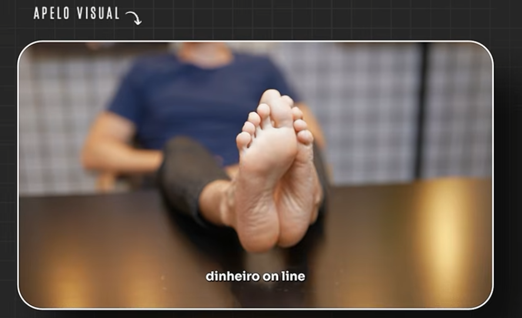

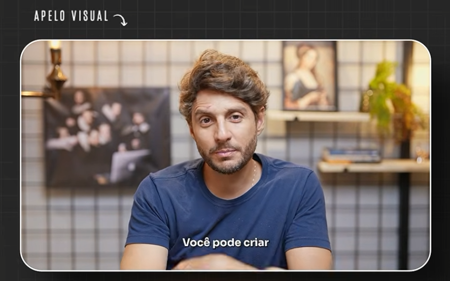

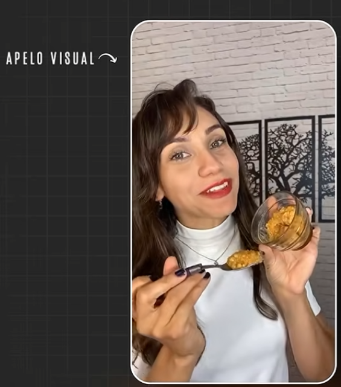

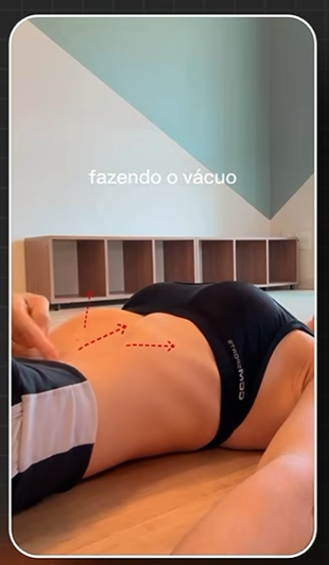

### O que é a ideia

Usar um **apelo visual conectado ao universo cultural do nicho como gancho de abertura de um vídeo**. O visual chama atenção porque remete a uma conversa, comportamento ou referência que a audiência já reconhece; depois, o vídeo muda para uma parte informativa, que desenvolve o tema, apresenta o produto e conduz ao pitch. A relação com o nicho dá sentido à brincadeira e torna o gancho mais pertinente do que uma imagem curiosa sem conexão.

Na primeira execução, o expert fala sobre ganhar dinheiro online e coloca os pés em primeiro plano, movimenta-os e joga uma meia. A cena brinca com a associação conhecida entre vender fotos dos pés em plataformas online e ganhar dinheiro. Em outra execução do mesmo ângulo, uma mulher mostra e come doce de leite diante da câmera. O alimento funciona como apelo visual relacionado ao assunto do vídeo, conforme o contexto informado pelo usuário. Em uma terceira execução, uma mulher demonstra um exercício de respiração abdominal; os movimentos do corpo e das mãos, junto às setas animadas, tornam a ação visível. Esses exemplos mostram que o apelo pode vir de uma referência cultural, de um objeto ou alimento, ou do próprio corpo em movimento, desde que haja relação com o assunto do vídeo. O gancho abre caminho para a parte informativa e o pitch.

### Como a peça funciona

1. **Referência pertinente ao nicho:** parte de uma associação cultural, comportamento ou conversa reconhecível pela audiência.
2. **Quebra de padrão visual:** traduz essa associação em uma ação, enquadramento ou elemento inesperado.
3. **Curiosidade e reconhecimento:** a pessoa entende ou tenta entender a brincadeira porque ela conversa com referências do nicho.
4. **Desenvolvimento do tema:** o expert explica o assunto, apresenta o produto e constrói o pitch.
5. **Chamada para ação:** conclui com o próximo passo da oferta.

### Variações do Mecanismo

- **Referência cultural do nicho:** usar uma prática, piada ou associação conhecida pela audiência como base do gancho.
- **Comportamento associado ao tema:** representar de forma visual uma atividade ou comportamento relacionado à conversa do nicho.
- **Corpo e gesto em movimento:** usar movimentos corporais, mãos ou motion gráfico para demonstrar uma ação relevante ao tema e captar atenção.
- **Brincadeira com uma crença ou tendência:** dramatizar uma ideia popular no nicho e depois contextualizá-la na parte informativa.
- **Microcena curiosa:** começar com uma situação curta que gere a pergunta “o que está acontecendo?”.
- **Contraste antes e depois do corte:** passar de uma cena excêntrica ou lúdica para uma explicação direta à câmera.
- **Som ou movimento como gatilho:** usar uma ação visual ou sonora breve para marcar a abertura antes da fala informativa.

### Adaptação por formato

- **Vídeo curto:** reservar os primeiros segundos para o gancho visual; fazer a transição para uma explicação objetiva, conectada ao tema, produto e pitch.
- **Estático:** adaptar o princípio como uma imagem de abertura com composição ou enquadramento inesperado; a sequência entre hook e conteúdo só pode ser preservada em legenda ou peça complementar.
- **Carrossel:** usar a primeira tela como interrupção visual e as seguintes para revelar o contexto, explicar o tema e apresentar a oferta.

## Referência 016 — Teatrinho / encenação

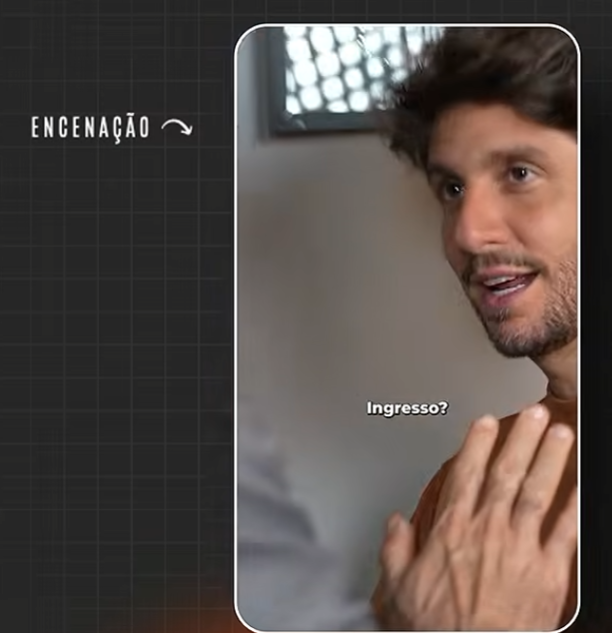

### O que é a ideia

Usar um **vídeo encenado, como um pequeno teatrinho**, para representar uma conversa ou situação familiar ao público. A narrativa conduz a audiência por um problema, desejo ou necessidade e introduz o produto como parte de um caminho possível para resolvê-lo ou alcançar o que a pessoa quer.

Na referência, o expert interpreta uma cena dialogada, com a pergunta “Ingresso?” aparecendo no primeiro trecho. A encenação conduz o espectador à necessidade e ao desejo relacionados ao produto. Na continuação, o expert apresenta diretamente a Fórmula de Lançamento, destaca que é paga e informa as datas, marcando a passagem da situação encenada para a apresentação concreta do produto e da oferta.

### Como a peça funciona

1. **Situação encenada:** abre com uma conversa, encontro ou acontecimento reconhecível.
2. **Personagens e falas:** uma ou mais pessoas representam perspectivas, dúvidas ou necessidades.
3. **Desenvolvimento do desejo ou problema:** a conversa revela o que o público quer, teme ou precisa resolver.
4. **Transição para o produto:** a cena encenada conduz à apresentação direta da solução ou possibilidade pertinente.
5. **Pitch e chamada:** a encenação conduz à explicação da oferta e ao próximo passo de compra.

### Variações do Mecanismo

- **Diálogo entre duas pessoas:** encenar uma conversa em que uma pessoa expressa uma dúvida ou necessidade e outra apresenta uma possibilidade.
- **Cliente e especialista:** dramatizar perguntas que o público faria e responder dentro da situação.
- **Pessoa e diálogo interno:** representar em cena o conflito entre desejo, receio e decisão.
- **Antes de conhecer a solução:** mostrar uma pessoa lidando com o problema antes de descobrir o produto ou método.
- **Situação de descoberta:** encenar o momento em que alguém percebe uma necessidade ou encontra uma nova possibilidade.
- **Objeção em conversa:** trazer uma resistência comum à compra e desenvolvê-la por meio das falas dos personagens.
- **Cena cotidiana com virada:** começar com uma situação simples e conduzi-la a uma revelação que introduz o produto.

### Adaptação por formato

- **Vídeo curto:** dividir a encenação em falas ou momentos breves; construir a necessidade ou o desejo e fazer a transição natural para a apresentação do produto e do pitch.
- **Estático:** congelar um momento expressivo da cena e usar uma fala ou legenda que sintetize o conflito ou desejo; a progressão narrativa precisa ser resumida no texto.
- **Carrossel:** distribuir a conversa em telas sequenciais, usando cada uma para avançar a situação até a entrada do produto e a chamada para ação.

## Referência 017 — Paródia musical

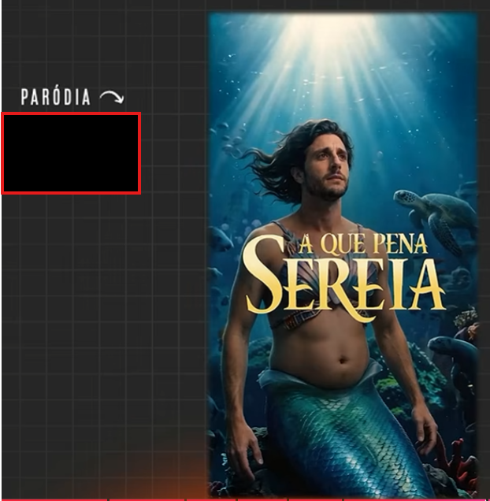

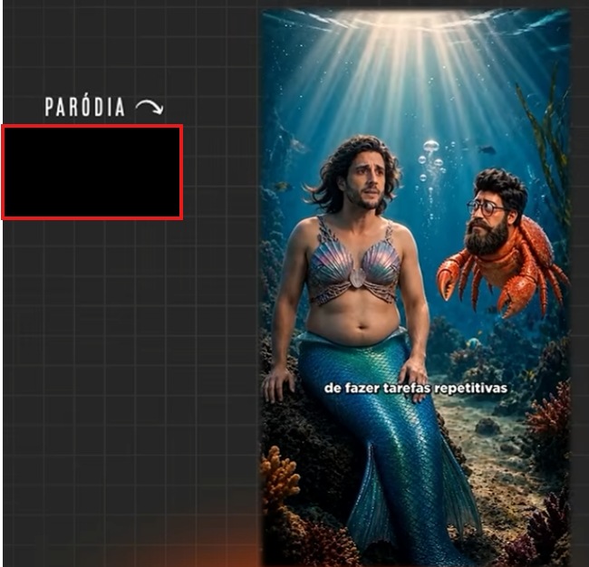

### O que é a ideia

Criar um **vídeo paródico que adapta uma música ou referência cultural conhecida para falar do nicho, do público e do produto**. O reconhecimento da obra original ajuda a chamar atenção; a mudança de letra, personagens e contexto traz a referência para a realidade da audiência e permite apresentar situações, problemas ou benefícios de forma divertida.

Na referência, a música da Pequena Sereia é parodiada em uma narrativa submarina com personagens que representam o público e o nicho. As cenas e os trechos visíveis associam o universo da sereia a tarefas repetitivas e ao produto anunciado. A paródia usa a familiaridade com a música e o contraste visual para transformar uma mensagem de venda em entretenimento temático.

### Como a peça funciona

1. **Referência reconhecível:** parte de uma música, cena ou obra cultural que o público identifica.
2. **Adaptação ao nicho:** transforma tema, letra ou contexto para refletir situações e vocabulário da audiência.
3. **Personagens e cenas temáticas:** representa o público, suas tarefas ou desafios dentro do universo parodiado.
4. **Integração do produto:** conecta a narrativa e a mensagem musical ao problema, benefício ou solução oferecida.
5. **Fechamento comercial:** conclui com a oferta e uma chamada para ação sem abandonar o tom da paródia.

### Variações do Mecanismo

- **Paródia de música conhecida:** adaptar ritmo ou estrutura musical para apresentar situações e ideias do nicho.
- **Paródia de cena ou filme:** recriar uma situação culturalmente reconhecível com personagens e problema do público.
- **Personagens de obra conhecida em novo contexto:** transportar arquétipos reconhecíveis para uma situação ligada ao produto.
- **Refrão como síntese da dor ou benefício:** usar uma frase musical repetível para reforçar uma mensagem central.
- **Narração ou diálogo paródico:** reinterpretar a linguagem de uma obra conhecida em uma conversa sobre o produto.
- **Universo visual temático:** usar figurino, cenário e objetos associados à referência cultural para compor uma narrativa de nicho.

### Adaptação por formato

- **Vídeo curto:** construir a paródia com música, letra adaptada, cenas temáticas e progressão até a apresentação do produto e da oferta.
- **Estático:** usar personagem, cenário ou frase visualmente reconhecível para comunicar a adaptação; a narrativa musical completa não se transfere para uma peça única.
- **Carrossel:** apresentar o universo e os personagens, desenvolver a paródia em etapas e concluir com a relação com o produto e a chamada.

